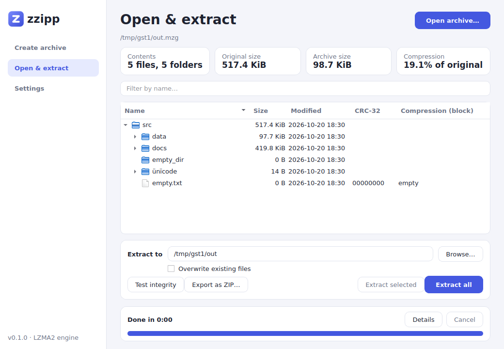

<!-- Paste this into README.md, e.g. after the "Features" list and before "Build". -->

## Desktop app

zzipp also ships a Qt 6 desktop app, `zzipp-gui`, built on the same engine and the same `.mzg` format:
create archives with drag and drop, browse their contents in a folder tree, extract everything or just the
files you select, test integrity, and export to ZIP, with progress, cancel and an activity log.

See [docs/GUI.md](docs/GUI.md) for usage, build instructions and current limitations. The GUI is optional:
without Qt installed, CMake builds the command-line tool only.

<!-- In "Build" add:  sudo apt install qt6-base-dev   (optional, for the GUI)
     In "Testing" the sanitizer line becomes:  cmake -S . -B build-asan -DZZIPP_SANITIZE=ON -DZZIPP_BUILD_GUI=OFF
     (the option is spelled ZZIPP_SANITIZE in CMakeLists.txt; your README said zzipp_SANITIZE) -->
