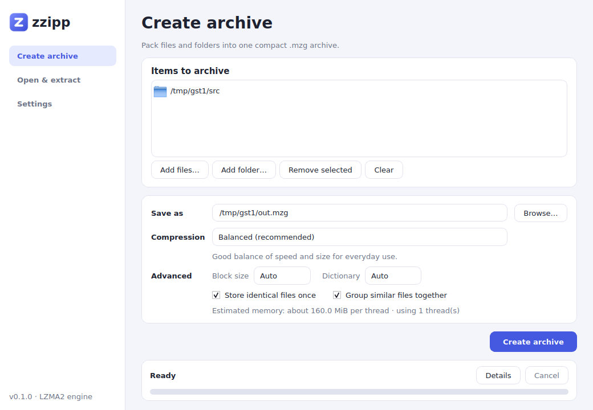
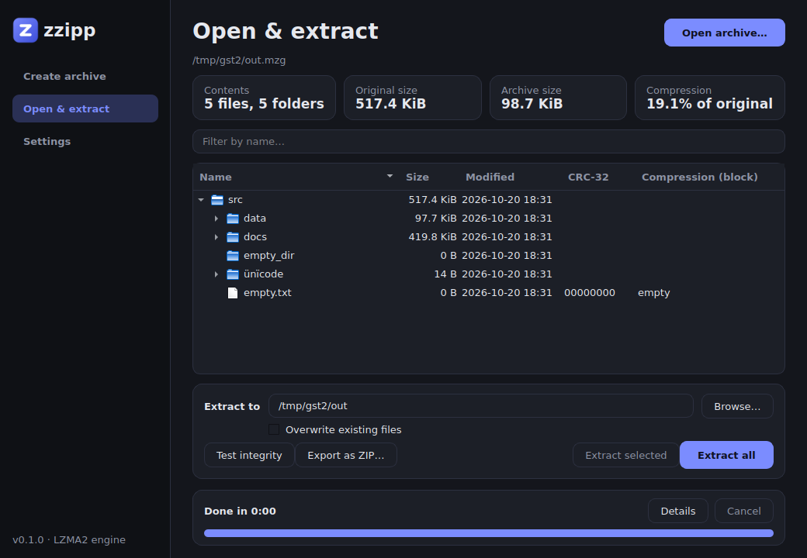

# zzipp desktop app

`zzipp-gui` is a Qt 6 Widgets front end for the same engine the command-line tool uses. It reads and writes
the same `.mzg` format, so archives are interchangeable between the two. The GUI links the engine directly
(no `QProcess`), which is what gives it live progress, cancellation and an in-memory archive browser.

| Create | Open & extract |
|---|---|
|  |  |

A dark theme is chosen automatically when the system palette is dark (`ZZIPP_THEME=dark|light` overrides it):



## What it does

- **Create archive.** Add files and folders (buttons or drag and drop from the file manager), choose the
  output name, pick *Fast / Balanced / Maximum*, and optionally set block size, dictionary size,
  deduplication and extension grouping. The page shows an estimate of memory per thread and automatically
  lowers the thread count if the estimate would exceed about 60% of physical RAM.
- **Open & extract.** Open a `.mzg` (button, drag and drop, or `zzipp-gui archive.mzg`). A sortable folder
  tree shows size, modified time, CRC-32 and, per file, the compression method and ratio of the block it
  lives in. Filter by name, then *Extract selected* or *Extract all* to a folder of your choice, with an
  optional overwrite switch.
- **Test integrity** verifies every block and file checksum. **Export as ZIP** converts the archive to a
  standard `.zip`.
- **Progress and settings.** A task bar shows status, percentage, elapsed time, *Cancel*, and a *Details*
  log with warnings (skipped symlinks, files that already exist, and so on). The Settings page holds the
  thread count and default overwrite behaviour. Settings are stored with `QSettings`.

## Behaviour worth knowing

- **Cancel** stops after the block that is currently compressing, so with large blocks it can take a few
  seconds to react. A cancelled *create* leaves no archive and no `.partial` file. A cancelled *extract*
  leaves the files it already wrote.
- Progress is per block, so with one huge block the bar moves in big steps. While scanning and
  deduplicating, the bar is an indeterminate busy indicator.
- Archives open instantly because only the index is read; file data is decoded when you extract or test.
- The whole folder tree is built in memory, which is fine for hundreds of thousands of entries but not
  designed for millions.

## Building

The GUI is optional. CMake builds it when Qt 6.2+ Widgets is found and otherwise builds the CLI only.

```bash
# Debian / Ubuntu
sudo apt install build-essential cmake liblzma-dev zlib1g-dev qt6-base-dev
cmake -S . -B build
cmake --build build -j
./build/src/gui/zzipp-gui
```

Disable it with `-DZZIPP_BUILD_GUI=OFF`.

### Windows (not yet verified)

I developed and tested the GUI on Linux only. The code avoids platform-specific APIs apart from the RAM
query (`GlobalMemoryStatusEx` on Windows), and the engine now converts paths as UTF-8, but nothing below has
been run on a Windows machine yet. A reasonable route:

1. Install Visual Studio 2022 (C++ workload), CMake, Qt 6 (MSVC 2022 64-bit kit) and [vcpkg](https://vcpkg.io).
2. `vcpkg install liblzma zlib --triplet x64-windows`
3. ```
   cmake -S . -B build -DCMAKE_TOOLCHAIN_FILE=<vcpkg>/scripts/buildsystems/vcpkg.cmake ^
         -DCMAKE_PREFIX_PATH=<Qt>/6.x/msvc2022_64
   cmake --build build --config Release
   ```
4. Bundle the app: `windeployqt --release build\src\gui\Release\zzipp-gui.exe`, plus the `lzma.dll` and
   `zlib1.dll` that vcpkg built.

Qt is licensed under the LGPLv3/GPL. Zzipp is Apache-2.0; if you distribute binaries, link Qt dynamically
(what `windeployqt` does) and ship Qt's license notices.

## Testing

`ctest` runs a headless GUI self-test (`QT_QPA_PLATFORM=offscreen`) that drives the real window code:
create an archive on the worker thread, open it, extract everything and a single file, test integrity,
export a ZIP and validate it with `unzip`, round-trip Unicode file names, and cancel a running create and
confirm nothing is left behind. It also checks the error paths: opening a non-archive, a missing input,
extracting onto a file, and re-extracting without overwrite must each produce a clear result without
crashing or corrupting state. `tests/edge_cases.sh` covers the command line the same way (usage errors,
exit codes, damaged archives, hostile timestamps) and fuzzes every command with corrupted archives.

```bash
ctest --test-dir build --output-on-failure -R gui
# regenerate the screenshots in docs/screenshots/
QT_QPA_PLATFORM=offscreen ./build/src/gui/zzipp-gui --selftest /tmp/zzipp-gui-test --screenshots docs/screenshots
```

## How it is structured

- `src/commands.hpp`: `Callbacks` (progress, log, cancel) added to each operation's options. With the
  hooks unset, the CLI behaves exactly as before.
- `src/gui/MainWindow.*`: pages, task runner (`QThread` plus a 100 ms UI timer so worker threads never
  touch widgets), archive browser.
- `src/gui/main.cpp`: theme, icon, command-line handling and the self-test.

## Not done yet

- Context menu and drag-out from the archive tree; preview of text files.
- Adding files to an existing archive (the format is write-once today).
- Windows installer, file association for `.mzg`, and an explorer shell extension.
- Translations (strings already go through `tr()`).
